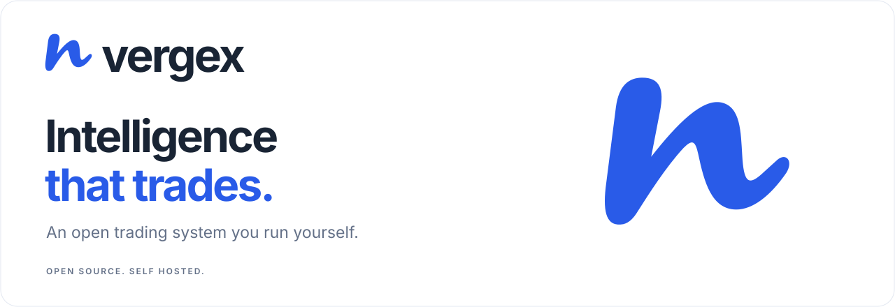

<p align="center">
  
</p>

<p align="center">
  <a href="README.md">English</a> ·
  <a href="README.zh-CN.md">中文</a>
</p>

<p align="center">
  <a href="https://github.com/rehuony/vergex/actions/workflows/ci.yml"></a>
  <a href="LICENSE"></a>
</p>

vergex is a self-hosted agent trading system for crypto USDT perpetual futures on **Binance** and **OKX**. You bring your own model API key and exchange API key; nothing is routed through a paid gateway and no usage data leaves your machine.

It is a personal project for a single user, and still in development. Until its database schema settles, an update may rebuild the schema without carrying old data over: see [docs/database.md](docs/database.md).

- **Dashboard** — a read-only overview: equity, open positions, what needs attention, and the last day's events.
- **Auto trading** — traders that run on their own: each reads the market, asks the model for decisions and places orders within the risk limits in its settings.
- **Grid trading** — a kind of trader that keeps a grid on one symbol, with market-regime checks.
- **Futures** — work through a trade with an agent on a live chart, compare entry plans (market, limit, ladder, TWAP) and approve each order yourself.
- **Forecast** — experimental coin signals from locally stored market data, with named strategies, backtests and every call checked afterwards. Nothing trades on them, and so far they have shown no edge.
- **Assistant** — one assistant in a window on every page and in a Telegram bot. It reads traders, accounts, positions, Futures plans and forecasts, creates and manages traders, and troubleshoots; in the web app it also fills in forms. Anything risky, such as starting a trader or closing a position, waits for your confirmation. The bot also sends alerts.

The interface is in English and Simplified Chinese.

## Requirements

| To | You need |
| :- | :------- |
| Run it | Docker with Compose v2, `make`, `openssl` |
| Develop | Go 1.26 (pinned in [go.mod](go.mod)), Node.js 24, pnpm 12 through Corepack (pinned in [web/package.json](web/package.json)), and Docker for PostgreSQL 17 |

## Run

```bash
git clone https://github.com/rehuony/vergex.git
cd vergex
make up
```

`make up` creates `.env` from `.env.example` on first run, generates `JWT_SECRET`, `DATA_ENCRYPTION_KEY`, `RSA_PRIVATE_KEY` and `DB_PASSWORD` if they are missing, then builds and starts the containers, PostgreSQL included. Open **http://127.0.0.1:8000**.

| Command | What it does |
| :------ | :----------- |
| `make init` | Create `.env` and fill missing keys (existing values are kept) |
| `make up` | `init`, then build and start |
| `make down` | Stop and remove the containers (the database volume is kept) |
| `make restart` | Restart the containers |
| `make logs [SERVICE=vergex-backend]` | Follow logs |
| `make status` | Container status and health check |
| `make backup` | Back up the database to `backups/` |
| `make restore FILE=… DB=…` | Restore a backup into a new database |
| `make regen-keys` | Regenerate all keys — stored account and model keys become unreadable |

`make help` lists the rest. To update, pull and run `make up` again. Keep `.env` and the `vergex-postgres` volume: they hold the keys and the database. Stopping the service does not close positions; check the exchange after restarts.

### Configuration

Settings come from `.env`, and `.env.example` explains each one. Models, accounts and traders are stored in the database and edited in the web UI.

| Variable | Default | What it sets |
| :------- | :------ | :----------- |
| `VERGEX_BIND_ADDRESS` | `127.0.0.1` | Where the web UI and its `/api/` proxy listen |
| `VERGEX_FRONTEND_PORT` | `8000` | The port they listen on |
| `VERGEX_BACKEND_PORT` | `3000` | The backend's port on the host, used only when its mapping in `docker-compose.yml` is uncommented |
| `VERGEX_AGENT_MAX_TOKENS` | `8000` | The most a model may write in one reply |

The database, encryption and CORS settings are in [docs/getting-started.md](docs/getting-started.md#configuration). For remote access keep the UI bound to `127.0.0.1` and put a TLS reverse proxy with an extra authentication layer in front: see [docs/deployment.md](docs/deployment.md).

### Development

```bash
make init          # once, for the keys in .env
make deps          # Go modules and frontend packages
make dev           # PostgreSQL from .env, backend on :3000, frontend on :8000 with /api proxied to :3000
```

`make test` runs the Go tests, which need PostgreSQL (`make run-postgresql`), and the frontend tests; `make lint` runs golangci-lint and ESLint. Conventions for working on the code are in [AGENTS.md](AGENTS.md), and how the interface looks in [DESIGN.md](DESIGN.md).

## First session

1. **Create the user.** The first registered user is the only user of the instance.
2. **Add a model** in Settings → Agent models: DeepSeek, OpenAI, Claude, Qwen, Gemini, Grok, Kimi or MiniMax with your own API key, optionally with a custom base URL and model name.
3. **Add an account** in Settings → Trading accounts: Binance or OKX USDT perpetuals ([API key guide](docs/accounts.md)). Bind the key to the server IP shown there. A [testnet account](docs/accounts.md#testnet) lets you try everything with test money.
4. **Open Futures** to plan a trade, or create a trader on the Auto trading page and set it up in its Settings tab.

Futures asks for approval on every order. A running trader places orders on its own; starting and stopping it are separate actions.

## Models, data and costs

Models are called directly with your key. Token usage of every call is stored locally and priced with the public [models.dev](https://models.dev) price list; Settings → Agent costs shows the estimated cost per model. Models without a published price are shown as unpriced.

Market data comes from free public endpoints: live exchange streams for candles and prices, kept in a local history, exchange order books, and coin rankings (24h volume, gainers, losers, open-interest change) computed from Binance public data. For OKX traders, ranked coins are limited to symbols that OKX lists.

## How execution works

- **Reviewable orders.** Futures shows account, sizing, entry and exit details before approval.
- **Account-aware sizing.** Futures sizes from the selected leverage and available margin, with costs reserved; tick size, step size and venue limits apply.
- **Exchange-side exits.** Stop-loss and take-profit orders are placed as fills are observed. Entry and protection are not atomic.
- **Reconciliation.** Uncertain submissions are checked against the exchange instead of being resubmitted.
- **Local secrets.** Account and model keys are stored AES-encrypted with `DATA_ENCRYPTION_KEY`. Protect `.env`, the database and backups.

## Architecture

```text
Browser (React)                Telegram bot
  Dashboard · Forecast ·         skill-first agent
  Futures · Traders ·                 │
  Settings · Assistant                │
          │                           │
          └──────── Gin API (/api) ───┘
                        │
              ┌─────────┴─────────┐
           Futures             Traders
          (futures/)          (trader/)
              └─────────┬─────────┘
                     Accounts
             venue/binance · venue/okx
                        │
            Binance / OKX USDT perpetuals

Models: agent/ provider clients   Storage: PostgreSQL (GORM)
```

The Go packages live under `internal/`. See [docs/architecture.md](docs/architecture.md) for the layout.

## Documentation

The full index is [docs/README.md](docs/README.md).

| Guide | Contents |
| :---- | :------- |
| [Getting started](docs/getting-started.md) | Install, configuration, first session, backups, user recovery |
| [Models](docs/models.md) | Providers, custom endpoints and costs |
| [Accounts](docs/accounts.md) | Binance and OKX API keys, testnet |
| [Dashboard](docs/dashboard.md) | The read-only overview |
| [Futures](docs/futures.md) | Planning, live execution and recovery |
| [Auto trading](docs/traders.md) | Settings, prompts, risk limits and grid |
| [Assistant](docs/assistant.md) | The assistant in the web app |
| [Telegram](docs/telegram.md) | Bot setup, skills, alerts and diagnostics |
| [Market data](docs/market-data.md) | Local candles, rate limits and history |
| [Forecast](docs/forecast.md) | Experimental signals, strategies and backtests |
| [Remote access](docs/deployment.md) | Reverse proxy with TLS and authentication |
| [Troubleshooting](docs/troubleshooting.md) | Common problems and fixes |
| [Architecture](docs/architecture.md) | Code layout and main flows |
| [Database](docs/database.md) | Schemas, conventions, adding a migration |
| [Fork record](docs/fork.md) | Why this fork exists and what it removed |

## License

[AGPL-3.0](LICENSE). vergex is a personal fork of NOFX (github.com/NoFxAiOS/nofx), maintained independently.

<sub>Automated trading involves substantial risk. Agent-driven strategies are experimental and can lose money. Size positions appropriately, understand each venue, and never trade funds you cannot afford to lose. See [DISCLAIMER.md](DISCLAIMER.md).</sub>
