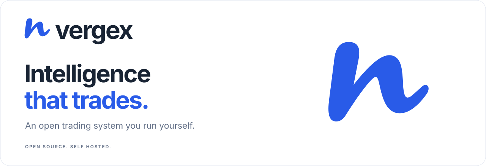

<p align="center">
  
</p>

<p align="center">
  <a href="README.md">English</a> ·
  <a href="README.zh-CN.md">中文</a>
</p>

<p align="center">
  <a href="https://github.com/rehuony/vergex/actions/workflows/ci.yml"></a>
  <a href="LICENSE"></a>
</p>

vergex 是一个自托管的 Agent 交易系统，面向 **Binance** 与 **OKX** 的加密货币 USDT 永续合约。模型 API Key 和交易所 API Key 都由你自己提供；不经过任何付费网关，也不会把使用数据发送到你的机器之外。

这是一个单用户的个人项目，仍在开发中。数据库结构定型之前，更新可能会重建结构而不迁移旧数据，见 [docs/database.md](docs/database.md)。

- **总览（Dashboard）** — 只读的全局视图：权益、持仓、需要处理的问题和最近一天的事件。
- **自动交易** — 自行运行的交易员：读取行情、请模型给出决策，并在自身配置的风控限制内下单。
- **网格交易** — 一种在单个币种上维持网格的交易员，带市场状态判断。
- **合约交易（Futures）** — 在实时图表上与 Agent 一起推演交易，比较多种入场方案（市价、限价、阶梯、TWAP），每一笔订单都由你亲自批准。
- **预测（Forecast）** — 基于本地行情数据的实验性币种信号，带可命名的策略和回测，每次判断都会事后核对。不用于交易，目前也没有显示出优势。
- **助手** — 同一个助手，既在网页每个页面的窗口里，也在 Telegram 机器人里。它能查看交易员、账户、持仓、合约交易计划和预测，创建和管理交易员，排查问题；在网页里还能帮你填写表单。启动交易员、平仓这类有风险的操作都要你确认。机器人还会推送告警。

界面提供英文和简体中文。

## 环境要求

| 用途 | 需要 |
| :--- | :--- |
| 运行 | Docker（含 Compose v2）、`make`、`openssl` |
| 开发 | Go 1.26（固定在 [go.mod](go.mod)）、Node.js 24、通过 Corepack 使用的 pnpm 12（固定在 [web/package.json](web/package.json)），以及用于 PostgreSQL 17 的 Docker |

## 运行

```bash
git clone https://github.com/rehuony/vergex.git
cd vergex
make up
```

首次运行时，`make up` 会从 `.env.example` 生成 `.env`，补齐缺失的 `JWT_SECRET`、`DATA_ENCRYPTION_KEY`、`RSA_PRIVATE_KEY` 和 `DB_PASSWORD`，然后构建并启动包括 PostgreSQL 在内的容器。打开 **http://127.0.0.1:8000**。

| 命令 | 作用 |
| :--- | :--- |
| `make init` | 创建 `.env` 并补齐缺失的密钥（已有值不覆盖） |
| `make up` | 先执行 `init`，再构建并启动 |
| `make down` | 停止并移除容器（保留数据库卷） |
| `make restart` | 重启容器 |
| `make logs [SERVICE=vergex-backend]` | 跟随日志 |
| `make status` | 容器状态与健康检查 |
| `make backup` | 把数据库备份到 `backups/` |
| `make restore FILE=… DB=…` | 把备份恢复到一个新数据库 |
| `make regen-keys` | 重新生成全部密钥——已保存的账户和模型密钥将无法解密 |

其余命令见 `make help`。更新时拉取代码后再次执行 `make up`。请保留 `.env` 和 `vergex-postgres` 卷：它们保存密钥和数据库。停止服务不会平仓，重启后请到交易所核对。

### 配置

配置来自 `.env`，每一项的说明见 `.env.example`。模型、账户和交易员保存在数据库里，在网页中编辑。

| 变量 | 默认值 | 作用 |
| :--- | :----- | :--- |
| `VERGEX_BIND_ADDRESS` | `127.0.0.1` | 界面及其 `/api/` 代理监听的地址 |
| `VERGEX_FRONTEND_PORT` | `8000` | 它们监听的端口 |
| `VERGEX_BACKEND_PORT` | `3000` | 后端在主机上的端口，只在取消 `docker-compose.yml` 中对应映射的注释后使用 |
| `VERGEX_AGENT_MAX_TOKENS` | `8000` | 模型单次回复最多写多少 token |

数据库、加密和 CORS 的设置见 [docs/getting-started.md](docs/getting-started.md#configuration)。远程访问时保持界面绑定在 `127.0.0.1`，在前面加一层带额外认证的 TLS 反向代理，见 [docs/deployment.md](docs/deployment.md)。

### 开发

```bash
make init          # 只需一次，用于生成 .env 中的密钥
make deps          # Go 模块和前端依赖
make dev           # 按 .env 启动 PostgreSQL，后端监听 :3000，前端 :8000 并把 /api 代理到 :3000
```

`make test` 运行 Go 测试（需要 PostgreSQL，可用 `make run-postgresql` 启动）与前端测试；`make lint` 运行 golangci-lint 和 ESLint。代码约定见 [AGENTS.md](AGENTS.md)，界面规范见 [DESIGN.md](DESIGN.md)。

## 首次使用

1. **创建账号。** 第一个注册的用户就是本实例唯一的用户。
2. **在“设置 → Agent 模型”中添加模型**：DeepSeek、OpenAI、Claude、Qwen、Gemini、Grok、Kimi 或 MiniMax，使用你自己的 API Key，可选自定义 base URL 和模型名。
3. **在“设置 → 交易账户”中添加账户**：Binance 或 OKX USDT 永续（[API Key 指南](docs/accounts.md)）。把 Key 绑定到该页面显示的服务器 IP。[测试网账户](docs/accounts.md#testnet)可以用测试资金把所有功能试一遍。
4. **打开合约交易** 规划交易，或在自动交易页面创建交易员，并在它的“配置”标签里调整。

合约交易的每一笔订单都需要批准。运行中的交易员会自行下单；启动和停止是单独的操作。

## 模型、数据与成本

模型直接用你的 Key 调用。每次调用的 token 用量都保存在本地，并按公开的 [models.dev](https://models.dev) 价格表估算；“设置 → Agent 费用” 中按模型显示估算成本。没有公开价格的模型显示为未定价。

行情数据来自免费公开接口：交易所实时流提供 K 线和价格并存入本地历史，另有交易所盘口，以及基于 Binance 公开数据计算的选币排行（24h 成交额、涨幅榜、跌幅榜、持仓量变化）。OKX 交易员的排行候选只保留 OKX 上可交易的币。

## 执行机制

- **可审阅的订单。** 合约交易在批准前展示账户、仓位、入场和出场细节。
- **按账户计算仓位。** 合约交易根据所选杠杆和可用保证金计算仓位并预留成本；价格精度、数量精度和交易所限制依然适用。
- **交易所侧止盈止损。** 观察到成交后挂出止损和止盈单。入场与保护不是原子操作。
- **对账。** 结果不确定的下单会到交易所核对，而不是盲目重发。
- **本地密钥。** 账户和模型密钥用 `DATA_ENCRYPTION_KEY` 进行 AES 加密存储。请保护好 `.env`、数据库和备份。

## 架构

```text
Browser (React)                Telegram bot
  Dashboard · Forecast ·         skill-first agent
  Futures · Traders ·                 │
  Settings · Assistant                │
          │                           │
          └──────── Gin API (/api) ───┘
                        │
              ┌─────────┴─────────┐
           Futures             Traders
          (futures/)          (trader/)
              └─────────┬─────────┘
                     Accounts
             venue/binance · venue/okx
                        │
            Binance / OKX USDT perpetuals

Models: agent/ provider clients   Storage: PostgreSQL (GORM)
```

Go 包都在 `internal/` 下，代码结构见 [docs/architecture.md](docs/architecture.md)。

## 文档

技术文档只提供英文版，完整索引见 [docs/README.md](docs/README.md)。

| 指南 | 内容 |
| :--- | :--- |
| [入门](docs/getting-started.md) | 安装、配置、首次使用、备份与用户恢复 |
| [模型](docs/models.md) | Provider、自定义接口与成本 |
| [账户](docs/accounts.md) | Binance 与 OKX 的 API Key、测试网 |
| [总览](docs/dashboard.md) | 只读的全局视图 |
| [合约交易](docs/futures.md) | 规划、实盘执行与恢复 |
| [自动交易](docs/traders.md) | 配置、提示词、风控上限与网格 |
| [助手](docs/assistant.md) | 网页里的助手 |
| [Telegram](docs/telegram.md) | 机器人配置、skill、告警与诊断 |
| [行情数据](docs/market-data.md) | 本地 K 线、限流与历史数据 |
| [预测](docs/forecast.md) | 实验性信号、策略与回测 |
| [远程访问](docs/deployment.md) | 带 TLS 和认证的反向代理 |
| [故障排查](docs/troubleshooting.md) | 常见问题与解决办法 |
| [架构](docs/architecture.md) | 代码结构与主要链路 |
| [数据库](docs/database.md) | Schema、约定与新增迁移 |
| [Fork 记录](docs/fork.md) | 这个 fork 的来由和移除的内容 |

## 许可证

[AGPL-3.0](LICENSE)。vergex 是 NOFX（github.com/NoFxAiOS/nofx）的个人 fork，独立维护。

<sub>自动交易存在重大风险。Agent 驱动的策略仍属实验性质，可能亏损。请合理控制仓位，了解每个交易所的规则，切勿投入无法承受损失的资金。详见 [DISCLAIMER.md](DISCLAIMER.md)。</sub>
